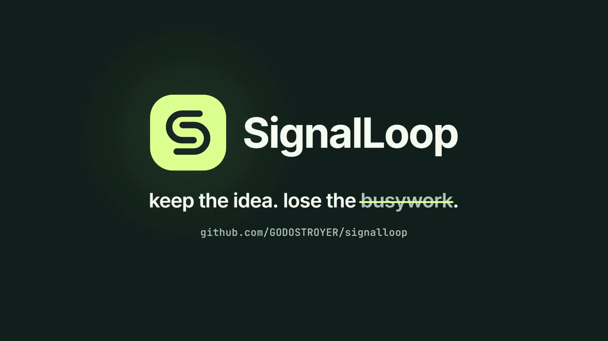

# SignalLoop

**Keep the idea. Lose the busywork.**

A working, local-first content repurposing prototype for The Product Space's **Media: content repurposing studio with brand memory** problem statement.

The interesting part is the loop, not another clipping button:

**Source → explained moments → platform copy → creator edits → approved brand rules → outcome evidence → a different next recommendation.**

## Watch the showcase (1:44)

[](https://github.com/GODOSTROYER/signalloop/raw/main/docs/media/signalloop-showcase.mp4)

▶ [Play the showcase video](docs/media/signalloop-showcase.mp4)

## v0.2: learning you can inspect

- **Learning lab:** compare the same source with and without approved memory. The aggregate excludes edited clips and reports measured rule violations, not fabricated audience lift.
- **Source guard:** surrounding transcript context, unsupported-number/certainty blocks and missing-qualification warnings. A lexical risk screen, not a complete fact checker.
- **Campaign planner:** goal-aware, non-overlapping selections with platform copy, source evidence, a decision trail, review gates and idempotent calendar planning.
- **Optional semantic review:** Gemini can select from the actual shortlist. Unknown clip IDs, duplicated selections and invented evidence quotes are rejected server-side.
- **Better long-source coverage:** scan the entire episode, preserve chronological coverage, then cap the shortlist at 80.
- **Safer memory:** arbitrary fact-changing replacements do not become reusable rules; legacy unsafe replacements are ignored. Length preferences preserve complete sentences.
- **Better output:** audio-only sources export branded waveform MP4s. Short readable caption phrases preserve the source wording, with timing interpolated within source segments.
- **CSV metrics and demo readiness:** real-result imports and an artifact-based submission checklist.

See [submission checklist](docs/SUBMISSION.md) and [three-minute walkthrough](docs/DEMO.md).

## Run it

Requires **Node.js 22.16+** (Node 24 recommended). The web app has **zero npm dependencies** and no frontend build step.

```bash
git clone https://github.com/GODOSTROYER/signalloop.git
cd signalloop
npm start
# Open http://127.0.0.1:3000
```

The studio opens with an original illustrative transcript. This is explicitly labeled a demo, not a customer's real podcast. No API key is required for the offline editorial engine.

### Media processing

Install FFmpeg/ffprobe for upload validation and MP4 export. Optional eSpeak creates the original spoken demo locally.

```bash
# macOS
brew install ffmpeg espeak

# Ubuntu/Debian
sudo apt-get update && sudo apt-get install -y ffmpeg espeak fonts-dejavu-core

# Generate playable original synthetic speech and accurate segment times.
# Run before starting the server. This resets only the demo brand.
npm run demo:media
npm start
```

For your own material, choose **New source**, upload your video/podcast and attach SRT, VTT or JSON. Upload limit defaults to 512 MB; media duration is limited to eight hours. Uploads stream to disk. JSON transcript example:

```json
[
  {"start": 0, "end": 24.5, "text": "A complete thought from your conversation."},
  {"start": 24.5, "end": 48, "text": "The next useful idea, with its original context."}
]
```

Plain text is supported for transcript exploration but is marked **estimated** and cannot be rendered. The app never fabricates a transcript when ASR is unavailable.

## Implemented

| Requirement | This build |
| --- | --- |
| Video/podcast ingestion | Streamed media upload, ffprobe validation, native playback and range serving. Optional local ASR worker. |
| Explainable clip selection | Transcript-boundary candidates, four visible rubric components, source quote, context warning, engine provenance. |
| Platform captions and copy | Instagram, YouTube and LinkedIn drafts; approved style rules; SRT/VTT downloads; real MP4 export in 9:16, 1:1 or 16:9 with optional burned captions. |
| Brand memory from edits | Persistent before/after pairs, conservative rule proposals, approval/disable controls, optimistic edit revisions, cross-source memory within the real creator brand. |
| Content calendar | Future editorial reminders, immutable copy snapshots and ICS export. Display timezone is Asia/Kolkata; storage is UTC. |
| Performance feedback | Validated JSON/CSV imports, stable post-ID upserts, platform-specific conservative reranking, a separate labeled synthetic sandbox and visible score deltas. |

**Important boundaries:** clip scoring is currently a transparent heuristic, not a trained virality predictor. Offline copy is extractive/template-based, not secretly an LLM. The calendar does not auto-publish. Analytics are imported, not fetched from social networks. Reframing is fit-and-pad, not face tracking. There is one real creator brand plus an isolated demo brand, not a multi-tenant account system. Original SRT/VTT downloads retain source segment timing; burned phrases interpolate within those segments. Neither is forced word alignment.

## Optional AI copy and semantic curation

Copy `.env.example` to `.env`, configure `GEMINI_API_KEY` and a model available to your project in `GEMINI_MODEL`, and restart. Choose a model currently available to your Google project; live model availability was not verified in this environment.

The **AI rewrite** action asks before sending the selected transcript, approved rules and up to three relevant edit pairs to Google. Requests use structured JSON output, timeouts and server-side credentials. The app validates the response and reapplies explicit style rules. Human fact review is still required. No key is bundled, logged or exposed in the browser.

The adapter follows Google's official REST documentation:
- https://ai.google.dev/api/generate-content
- https://ai.google.dev/gemini-api/docs/structured-output

Campaign planning also offers a consent-gated semantic review of up to 32 candidates spread across the episode. Evidence quotes must be literal source substrings, and all clip IDs are checked. The planner remains a hybrid of model suggestions and deterministic constraints.

A live provider call was **not verified** in the build environment because no provider credential was supplied.

## Optional local transcription

```bash
python3 -m venv .venv
source .venv/bin/activate
pip install -r scripts/requirements.txt
# Set ENABLE_WHISPER=1 in .env. Optionally set PYTHON_BIN to the venv python.
npm start
```

Upload media without a transcript, then choose **Transcribe**. `faster-whisper` runs locally with an explicit job state. The selected model downloads on first use; network access and sufficient RAM are required. Default: `base`, CPU, int8. A server restart marks unfinished jobs failed rather than pretending they completed. See the upstream implementation at https://github.com/SYSTRAN/faster-whisper.

Local ASR execution was **not verified** here because the optional package and model were unavailable. Timed-transcript import and actual FFmpeg rendering were verified.

## Demonstrate the differentiator

1. Generate Instagram copy. Remove its hashtag and save the edit.
2. Open **Brand memory** and approve the proposed no-hashtag preference.
3. Select another moment and regenerate its Instagram draft. The hashtag disappears; the rule remains scoped to Instagram. This also transfers across real sources in the same creator brand.
4. Open **Performance loop** and load **illustrative results**. The clearly labeled synthetic how-to cohort raises how-to moments in the shortlist.
5. Clear the fixture. Content-only rankings return. Synthetic observations cannot influence the real brand.
6. Plan a post and export a real captioned MP4. See `docs/DEMO.md` for a three-minute walkthrough.

## Tests

```bash
npm run check
npm test
```

Tests cover transcript validation, selection provenance, memory approval and reuse, stale-edit rejection, cohort separation, idempotent metrics, reranking, calendar export, authentication and origin/Host checks, plus real upload → FFmpeg → captioned MP4 → range download. The media integration test explicitly skips when FFmpeg is absent; the implementation environment ran it successfully.

A real browser smoke workflow is included in GitHub Actions: it exercises edit → approve → memory proof → campaign → review → calendar → source guard → feedback → actual MP4 → mobile, and uploads screenshots. Inspect the actual workflow result for verification. Run it locally with `pip install playwright==1.57.0`, `python -m playwright install chromium`, and `python scripts/browser-smoke.py`. Its data is isolated from your own workspace.

Build-environment browser note: direct Chromium navigation to localhost was blocked by the execution environment (`ERR_BLOCKED_BY_ADMINISTRATOR`). Desktop/mobile views were rendered offline using the actual view modules and API state. Do not confuse that with a completed live browser end-to-end run. AI rewriting and local Whisper still require live verification.

## Architecture and persistence

- `public/`: modular native JavaScript, semantic HTML, responsive CSS. No external CDN, remote font or build dependency.
- `server/domain.mjs`: deterministic scoring, transcript parsing, rules, captions, feedback and calendar logic.
- `server/index.mjs`: HTTP API, validation, streaming uploads, sessions and static serving.
- `server/db.mjs`: SQLite WAL storage and atomic transactions using Node's built-in `node:sqlite`.
- `server/media.mjs`: bounded serial media job queue; FFmpeg and local ASR subprocesses, without shell interpolation.
- `server/ai.mjs`: optional structured-output copy and source-grounded editorial review.
- `server/editorial.mjs`, `server/lab.mjs`: source guards, memory evaluation, campaign selection and approval routes.
- `server/caption-layout.mjs`: source-preserving phrase captions and title wrapping.
- `.signalloop/`: local SQLite database, uploads and exports, excluded from Git.

Native SQLite may emit an experimental warning on Node 22. The prototype uses APIs available in 22.16. See https://nodejs.org/api/sqlite.html.

## Deployment and privacy

No hosted service is provisioned by this repository. Start locally, or use the included Dockerfile on a persistent host. **This is not a serverless Vercel function deployment:** it needs a writable volume and long-running FFmpeg jobs.

```bash
docker build -t signalloop .
# Replace with a long random secret, supplied through your secret manager or shell.
docker run --rm -p 3000:3000 \
  -e ACCESS_TOKEN="$SIGNALLOOP_ACCESS_TOKEN" \
  -v signalloop-data:/app/.signalloop signalloop
```

A non-loopback bind requires an access token of at least 24 characters. The server exchanges it for an HTTP-only, SameSite session cookie; it never places credentials in media URLs. Put public deployments behind HTTPS and set `COOKIE_SECURE=1`. The Docker configuration was authored but not built in this environment.

This is still a single-user prototype: add real identity, resource quotas, worker/container isolation, authenticated tenancy, durable distributed jobs, backup/retention controls and an independent security review before handling other creators' private media. Never commit `.env`, uploaded footage or `.signalloop`.

## Next implementation priorities

1. Verify ASR and the AI adapter against actual credentials/media, then evaluate semantic curation on real creator recordings and multilingual material.
2. Add editable segment boundaries, forced word alignment and face-aware reframing with human review.
3. Connect platform OAuth, analytics ingestion and publishing, respecting each platform's capabilities and approvals.
4. Replace heuristic performance updates with evaluated creator-specific models when enough comparable observations exist.

A functioning prototype is evidence of implementation, not evidence of winning the hackathon or achieving content-performance lift.
